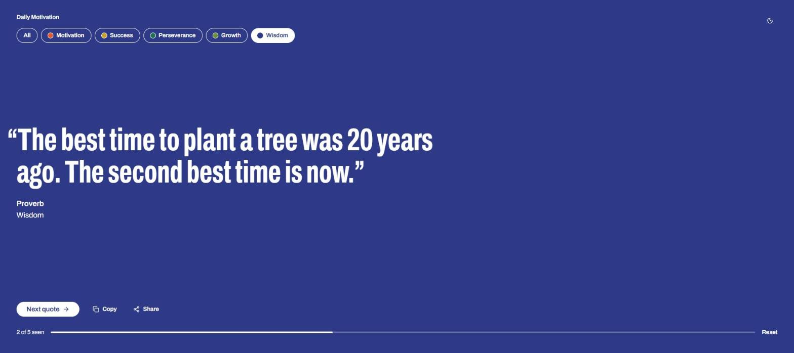
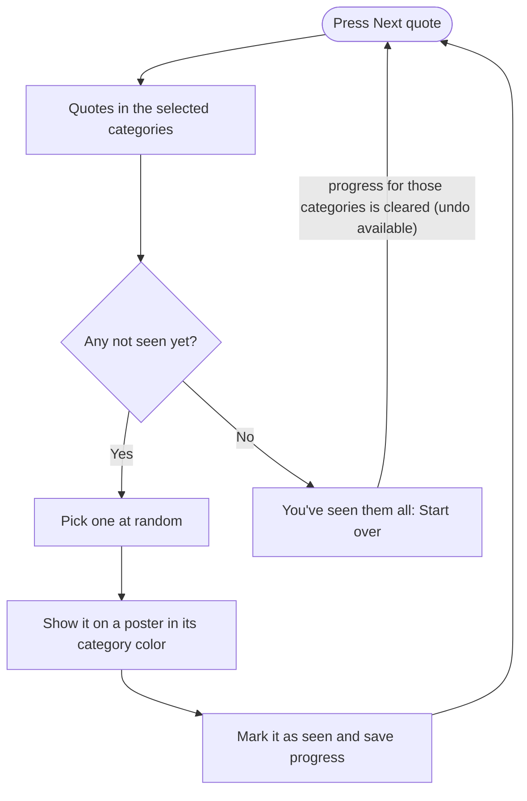
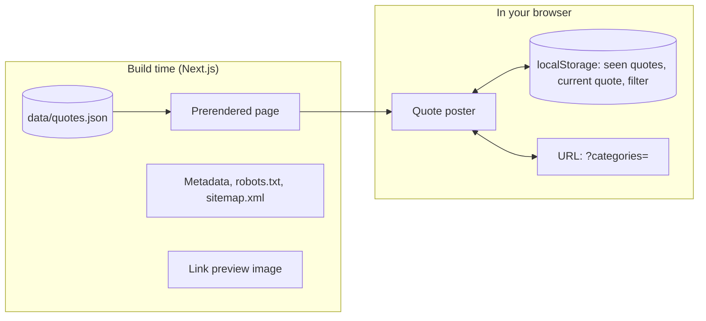
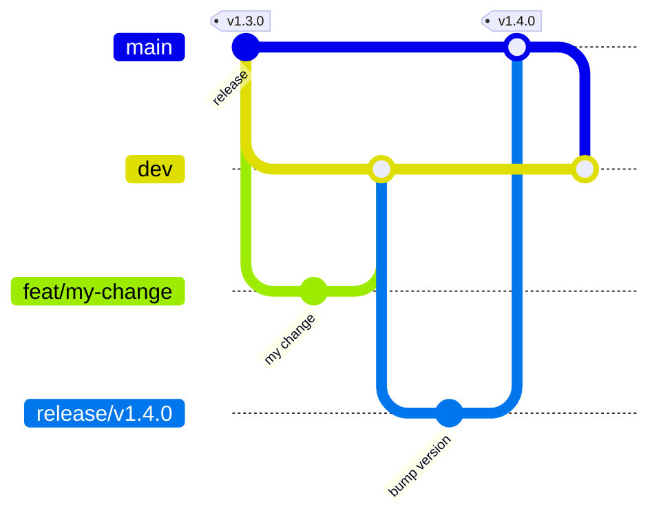

# Daily Motivation

[](https://github.com/dbarretol/quotes-app/actions/workflows/ci.yml)
[](https://github.com/dbarretol/quotes-app/releases/latest)
[](LICENSE)

A small web app that shows motivational quotes one at a time, like posters, and never repeats one
until you have seen them all.

**Try it:** [quotes-app-delta.vercel.app](https://quotes-app-delta.vercel.app/)



## Contents

- [Features](#features)
- [How it works](#how-it-works)
- [Tech stack](#tech-stack)
- [Getting started](#getting-started)
- [Adding quotes](#adding-quotes)
- [Project structure](#project-structure)
- [Contributing](#contributing)
- [License](#license)

## Features

- **One quote at a time**, with its author and category, set large like a poster.
- **A color for each category.** The whole screen takes the color of the quote on display.
- **No repeats.** Quotes are picked at random from the ones you haven't seen yet.
- **Progress that stays.** What you've seen is saved in your browser, so you can close the tab and
  pick up later. You can start over at any time, and undo it.
- **Category filter.** Choose one or more categories. The filter is kept in the URL, so a filtered
  link can be shared (for example `?categories=wisdom`).
- **Copy and share** a quote (sharing uses your device's share menu where the browser supports it).
- **Light and dark themes**, following your system setting by default.
- **Private by design.** No accounts, no analytics and no server-side storage: progress lives only
  in your browser's local storage.

## How it works

Each press of **Next quote** picks a random quote among the ones not yet seen in the selected
categories:



The app is a single page. Everything is prerendered at build time and the quote logic runs in the
browser, so there is no backend or database:



When a link to the app is shared, chat apps and social networks show a preview image generated at
build time:


## Tech stack

| Area | Choice |
|---|---|
| Framework | [Next.js](https://nextjs.org/) 16 (App Router, Turbopack) and React 19 |
| Language | TypeScript |
| Styling | [Tailwind CSS](https://tailwindcss.com/) 3 |
| Type | [Archivo](https://fonts.google.com/specimen/Archivo), condensed for quotes |
| Themes | [next-themes](https://github.com/pacocoursey/next-themes) |
| Icons | [Lucide](https://lucide.dev/) |
| Hosting | [Vercel](https://vercel.com/) |
| CI | GitHub Actions on Node.js 22, 24 and 26, plus Dependabot |

## Getting started

Requirements: Node.js 20.9 or later and npm.

```bash
git clone https://github.com/dbarretol/quotes-app.git
cd quotes-app
npm install
npm run dev
```

Then open [http://localhost:3000](http://localhost:3000).

| Command | Description |
|---|---|
| `npm run dev` | Start the development server |
| `npm run build` | Create a production build (includes type checks) |
| `npm run start` | Serve the production build |
| `npm run lint` | Run ESLint |
| `npm run typecheck` | Run the TypeScript compiler without emitting files |
| `npm run validate:quotes` | Validate `data/quotes.json` |

## Adding quotes

Quotes live in [`data/quotes.json`](data/quotes.json) as a list of objects:

```json
{
  "id": "courage-to-continue",
  "text": "Success is not final, failure is not fatal: it is the courage to continue that counts.",
  "author": "Winston Churchill",
  "category": "Motivation",
  "attributed": true
}
```

| Field | Required | Description |
|---|---|---|
| `id` | yes | Unique, kebab-case. Saved progress refers to it, so don't change it once published |
| `text` | yes | The quote |
| `author` | yes | Author name, or `null` if unknown |
| `category` | yes | Any category name; new categories are picked up automatically |
| `attributed` | no | `true` when the attribution is popular but unverified (shown as "attributed to …") |

Run `npm run validate:quotes` to check the file; CI runs it on every pull request.

The five current categories have their own colors in
[`lib/category-theme.ts`](lib/category-theme.ts). A new category works right away with a neutral
color; add a light and a dark color pair there to give it its own (keep text contrast at 4.5:1 or
more).

## Project structure

```
app/            Next.js App Router: layout, page, styles, robots, sitemap, preview images
components/     UI components: category filter, quote actions, theme toggle, buttons
data/           Quote collection (quotes.json)
docs/           Images used in this README
lib/            Quote helpers, category colors, saved progress, URL filter, site settings
scripts/        Maintenance scripts (quote validation)
```

## Contributing

Issues and pull requests are welcome. The repository uses two long-lived branches:

- `main` is what runs in production; each release is tagged (`v1.3.0`, …).
- `dev` collects finished work before the next release.



1. Create a branch from `dev` (for example `feat/…`, `fix/…`, `docs/…`).
2. Before opening a pull request, run `npm run lint`, `npm run typecheck`,
   `npm run validate:quotes` and `npm run build`.
3. Open the pull request against `dev`. CI must pass before it can be merged.

Releases are cut from `dev` on a `release/…` branch, merged into `main` and tagged; `main` is then
merged back into `dev`.

Changes are listed in the [changelog](CHANGELOG.md) and on the
[releases page](https://github.com/dbarretol/quotes-app/releases).

## License

[MIT](LICENSE)
